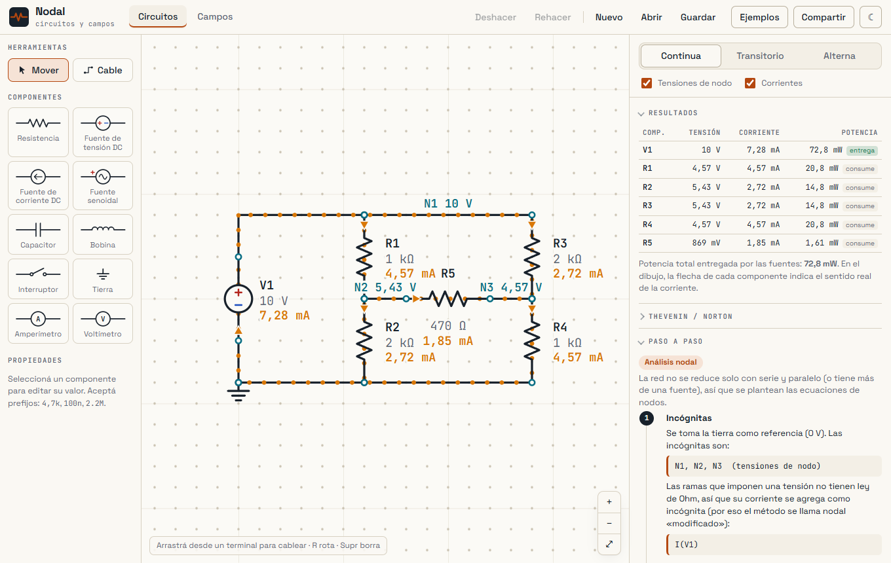
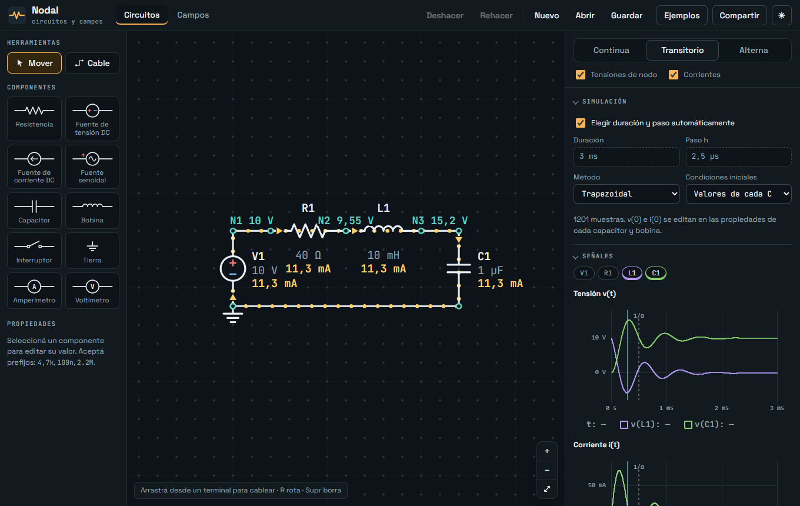
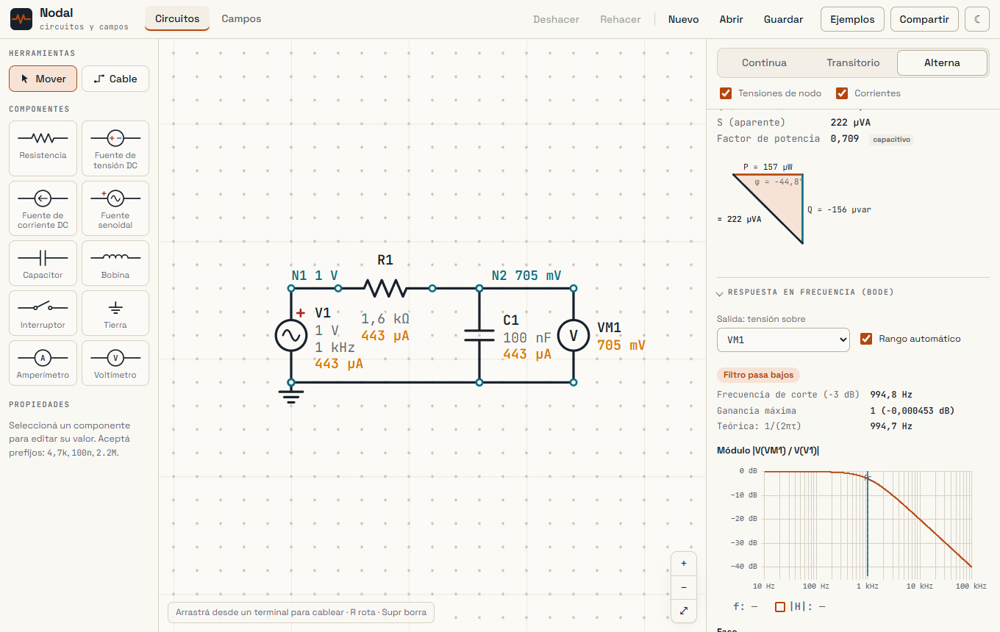
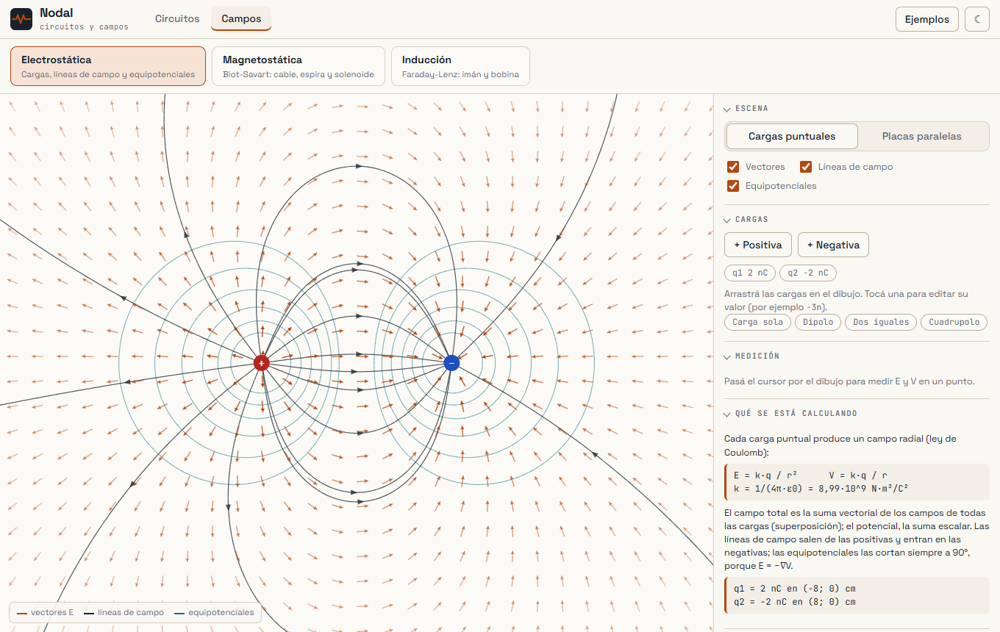
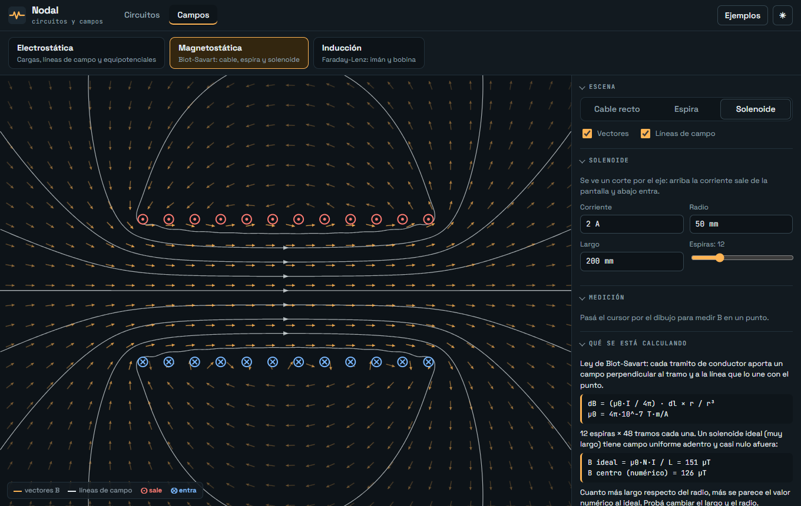
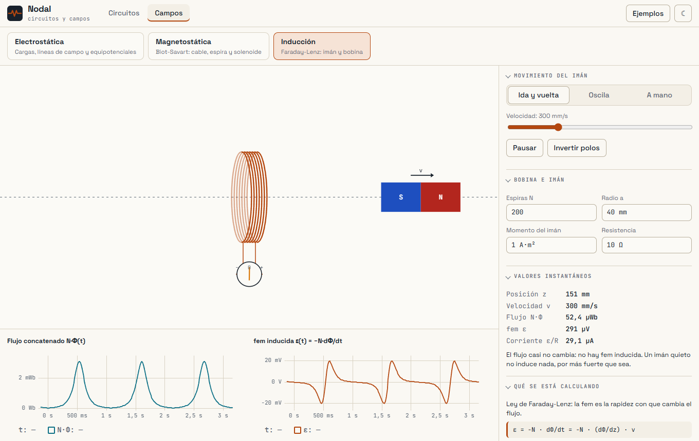
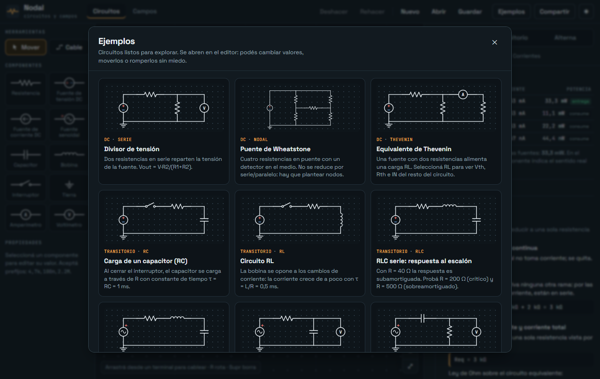

# Nodal · simulador de circuitos y campos

Simulador web educativo de circuitos eléctricos y electromagnetismo, en español, pensado para
estudiantes de ingeniería (Física II, Electrotecnia, Electrónica). Se dibuja el circuito, se
ven tensiones y corrientes en vivo, y cada resultado viene con su explicación paso a paso con
los números reales del circuito. Corre entero en el navegador, sin backend.

**▶ Demo:** https://stikyu.github.io/simulador-circuitos/



|                                                                     |                                                                |
| ------------------------------------------------------------------- | -------------------------------------------------------------- |
|      |  |
|  |         |
|           |                    |

Ejemplos que se abren directo desde el link:
[divisor](https://stikyu.github.io/simulador-circuitos/#ejemplo=divisor) ·
[Wheatstone](https://stikyu.github.io/simulador-circuitos/#ejemplo=wheatstone) ·
[carga de capacitor](https://stikyu.github.io/simulador-circuitos/#ejemplo=carga-capacitor) ·
[RLC al escalón](https://stikyu.github.io/simulador-circuitos/#ejemplo=rlc-escalon) ·
[RLC resonante](https://stikyu.github.io/simulador-circuitos/#ejemplo=rlc-resonante) ·
[filtro RC](https://stikyu.github.io/simulador-circuitos/#ejemplo=filtro-rc) ·
[campos](https://stikyu.github.io/simulador-circuitos/#campos=electro)

## Funcionalidades

### Etapa 1 – Editor

- [x] Grilla con snap, paneo y zoom
- [x] Colocar componentes, conectar por terminales (arrastrando o con la herramienta Cable)
- [x] Mover (los cables enganchados acompañan), rotar, borrar, duplicar, selección múltiple
- [x] Valores con unidades y prefijos: `4,7k`, `100n`, `2.2M`, `10 µF`
- [x] Deshacer / rehacer
- [x] Guardar y abrir JSON, autoguardado en `localStorage`

### Etapa 2 – Circuitos DC

- [x] Resolución por análisis nodal modificado (MNA)
- [x] Tensión de cada nodo, corriente por rama animada en su sentido real, potencia por componente
- [x] Amperímetro y voltímetro, fuente de corriente
- [x] Equivalente de Thevenin / Norton visto desde la resistencia seleccionada
- [x] Paso a paso: reducción serie/paralelo con resistencia equivalente o, si no se puede,
      ecuaciones nodales planteadas y resueltas
- [x] Errores explicados y resaltados: falta de tierra, nodos flotantes, fuentes en paralelo,
      lazos de bobinas y fuentes, matriz singular

### Etapa 3 – Capacitores, bobinas y transitorios

- [x] Capacitor, bobina e interruptor temporizado
- [x] Simulación en el tiempo con gráficos v(t) e i(t) de los componentes elegidos
- [x] τ = RC y τ = L/R marcadas en la curva
- [x] RC, RL y RLC (sub, crítico y sobreamortiguado) con su ecuación diferencial y solución
- [x] Cursor temporal: el circuito muestra las tensiones y corrientes del instante elegido
- [x] Comparación con la solución analítica superpuesta

### Etapa 4 – Corriente alterna

- [x] Fuente senoidal (amplitud, frecuencia, fase)
- [x] Impedancia de cada componente y total
- [x] Diagrama fasorial animado
- [x] P, Q, S, factor de potencia y triángulo de potencias
- [x] Diagrama de Bode (módulo y fase)
- [x] Frecuencia de resonancia, ancho de banda y Q; detección de pasa bajos / altos / banda

### Etapa 5 – Campos

- [x] Electrostática: cargas puntuales arrastrables, vectores, líneas de campo, equipotenciales
- [x] Placas paralelas (con efectos de borde y comparación con E = V/d)
- [x] Magnetostática con Biot-Savart: cable recto, espira y solenoide
- [x] Inducción: imán y bobina con gráficos de flujo y fem (Faraday-Lenz)
- [x] Cada escena explica la fórmula usada y los valores

### Etapa 6 – Pulido

- [x] Galería de ejemplos precargados
- [x] Compartir un circuito por link (estado comprimido en la URL)
- [x] Modo claro / oscuro
- [x] Diseño responsive
- [x] Accesibilidad básica: navegación por teclado, foco visible, etiquetas ARIA,
      `prefers-reduced-motion`

## Atajos de teclado

| Tecla                 | Acción                                         |
| --------------------- | ---------------------------------------------- |
| `V` / `W`             | Herramienta Mover / Cable                      |
| `R`                   | Rotar la selección (o el componente a colocar) |
| `Supr`                | Borrar                                         |
| `Ctrl+Z` / `Ctrl+Y`   | Deshacer / rehacer                             |
| `Ctrl+D` / `Ctrl+A`   | Duplicar / seleccionar todo                    |
| Flechas               | Mover la selección una celda                   |
| `Tab` y `Enter`       | Recorrer y seleccionar componentes             |
| `Enter` (al colocar)  | Poner el componente en el centro de la vista   |
| `Esc`                 | Cancelar                                       |
| Rueda · botón central | Zoom · paneo                                   |

## Stack

- **React 19 + TypeScript estricto + Vite**
- Editor sobre **SVG** con grilla propia (sin librerías de diagramas)
- Solver propio: eliminación gaussiana con pivoteo parcial, real y complejo
- **uPlot** para los gráficos, **lz-string** para comprimir el link
- **Vitest** (139 tests), ESLint, Prettier
- Sin backend

## Cómo correrlo

```bash
npm install
npm run dev        # servidor de desarrollo
npm test           # tests
npm run lint       # ESLint
npm run build      # compilación de producción en dist/
npm run preview    # servir la compilación
npm run capturas   # regenerar las capturas del README (requiere preview corriendo)
npm run deploy     # publicar dist/ en la rama gh-pages
```

## Arquitectura

```
src/
  engine/      Motor de cálculo: MNA, DC, transitorio, AC. Sin dependencias de React.
  components/  Definición de cada componente y cómo estampa en la matriz MNA.
  explain/     Generadores de explicaciones paso a paso.
  fields/      Campos eléctrico y magnético.
  editor/      Grilla, colocación, cables, selección, historial, guardado, compartir.
  ui/          Layout, paneles, gráficos, galería, tema.
  examples/    Circuitos precargados.
tests/         El motor validado contra resultados analíticos.
docs/          Documentación técnica y capturas.
```

El circuito es un grafo serializable a JSON. `engine/` se puede usar y testear sin la interfaz.

## Cómo funciona el motor

1. **Del dibujo al grafo.** Con union-find se agrupan en un mismo _nodo_ todos los puntos
   unidos por cables. La tierra es el nodo 0.
2. **Validación.** Antes de resolver se buscan sobre el grafo nodos flotantes, lazos de fuentes
   y fuentes en corto, para poder explicar el problema y señalar los componentes.
3. **Estampado.** Cada componente aporta a la matriz `A·x = b` con una de dos primitivas:
   una admitancia (`i = Y·v + Ieq`) o una rama de tensión (`va − vb = V`, que agrega su
   corriente como incógnita). Eso es el análisis nodal _modificado_.
4. **Resolución.** Eliminación gaussiana con pivoteo parcial y escalado de filas.
5. **Transitorio.** Capacitores y bobinas se reemplazan en cada paso por una conductancia y
   una fuente de corriente (modelo equivalente con regla trapezoidal), así que cada paso es
   un problema resistivo. El paso de cada conmutación se hace con Euler hacia atrás.
6. **Alterna.** La misma matriz con admitancias complejas (`1/R`, `jωC`, `1/(jωL)`) y las
   fuentes como fasores. El Bode es repetirlo para muchas frecuencias.

El detalle, con las derivaciones, la tabla de sellos de cada componente y el porqué de cada
decisión, está en **[docs/arquitectura.md](docs/arquitectura.md)**.

## Limitaciones

- Solo componentes lineales (sin diodos ni transistores).
- Paso de tiempo fijo; cada interruptor conmuta una sola vez.
- Alterna a una única frecuencia.
- El voltímetro y el interruptor abierto se modelan con 1 GΩ.
- Los cables no se re-rutean solos al mover componentes (se estiran).
- El cableado necesita mouse o pantalla táctil; el resto se puede hacer con teclado.
- Campos en 2D; el imán de la escena de inducción es un dipolo ideal.

## Publicación

La demo se publica en GitHub Pages desde la rama `gh-pages` con `npm run deploy` (compila y
sube `dist/`).

El workflow de GitHub Actions para publicar automáticamente en cada push a `main` está escrito
pero todavía no subido: GitHub exige el permiso `workflow` en el token para aceptar archivos de
Actions. Para activarlo:

```bash
gh auth refresh -s workflow        # otorga el permiso (abre el navegador)
git cherry-pick ci/pages-workflow  # trae .github/workflows/deploy.yml (rama local)
git push
gh api -X PUT repos/Stikyu/simulador-circuitos/pages -f build_type=workflow
```

## Licencia

[MIT](LICENSE)
